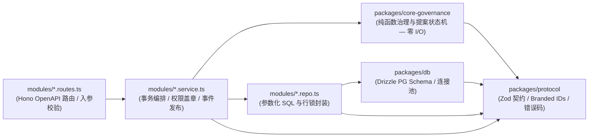

# OpenHuddle 全栈编码、注释、架构与文档规范

> **适用范围**：本仓库内所有人类开发者与 AI 编程智能体（Antigravity、Codex、Claude Code、Cursor、DeepSeek 等）。  
> **核心理念**：代码不仅是给编译器执行的指令，更是给人类架构师审查与给下一棒 AI 智能体读取的**高信噪比工程契约**。任何提交合并的代码必须同时满足**「强类型严密性、清晰架构边界、高价值注释、完备同步文档」**四项标准。

---

## 1. TypeScript 严格编码规范（Google TS Style + Total TypeScript 实践）

### 1.1 编译器与静态检查红线（`tsconfig.base.json` & `biome.json`）
全仓所有包统一继承最严编译基线，**严禁在子包中弱化检查级别**：
- **必开编译选项**：
  - `"strict": true`（含 `strictNullChecks`, `noImplicitAny` 等全套检查）
  - `"noUncheckedIndexedAccess": true`（数组下标与字典索引返回 `T | undefined`，强制判空防越界崩溃）
  - `"exactOptionalPropertyTypes": true`（区分“属性缺失”与“属性值为 `undefined`”）
  - `"noImplicitReturns": true` & `"noFallthroughCasesInSwitch": true`
  - `"verbatimModuleSyntax": true`（强制使用 `import type { ... }` 分离纯类型导入，加速打包与裁剪）
- **Biome 强制规则**：
  - `noExplicitAny: "error"` —— **零 `any` 容忍**；未知外部输入一律声明为 `unknown` 并通过 Zod Schema 或类型守卫（Type Guard）收窄。
  - `noFloatingPromises: "error"` —— 所有异步 `Promise` 必须 `await`、`return` 或显式 `void` 并附错误兜底，杜绝未捕获异步异常冲垮 Node 进程。

### 1.2 模块导出与命名约定
1. **统一具名导出（Named Exports Only）**：除前端路由框架（如 TanStack Router 文件路由）强制要求的导出形式外，**一律禁止 `export default`**，确保全仓重构符号重命名与自动导入 100% 准确。
2. **命名风格**：
   - **类型 / 接口 / 类 / 枚举类型 / React 组件**：`UpperCamelCase`（如 `GovernanceState`, `ProposalCard`）。
   - **函数 / 变量 / 方法 / Hook / 实例**：`lowerCamelCase`（如 `computeAuthorTrust`, `useRoomEvents`）。
   - **全局编译期常量 / 配置阈值**：`CONSTANT_CASE`（如 `DEFAULT_MAX_CONSECUTIVE_AGENT_TURNS = 6`）。
   - **文件名**：统一使用 `kebab-case.ts`（如 `turn-budget.ts`, `messages.repo.ts`），组件文件同样推荐 `proposal-card.tsx`，避免大小写敏感文件系统（macOS vs Linux 容器）引发构建事故。

### 1.3 高阶类型安全模式（必用三大惯用法）

#### （1）名义品牌类型（Branded Types）—— 杜绝原始字符串 ID 混传
禁止在核心业务签名中裸用 `string` 表示实体 ID 或用普通 `number` 表示消息序号 `seq`，必须在 `packages/protocol` 中定义为品牌类型：

```typescript
/**
 * 构造编译期互不兼容的名义品牌类型，防止将 AgentId 误传给接收 RoomId 的函数。
 */
export type Brand<T, TBrand extends string> = T & { readonly __brand: TBrand };

export type UserId = Brand<string, "UserId">;
export type AgentId = Brand<string, "AgentId">;
export type RoomId = Brand<string, "RoomId">;
/** 房间内严格单调递增（1..N）的消息序号 */
export type MessageSeq = Brand<number, "MessageSeq">;
```

#### （2）可辨识联合类型（Discriminated Unions）+ `assertNever` 穷尽检查
所有多态事件（SSE 事件帧、消息类型、治理拦截原因）必须以字面量字段（如 `kind` 或 `type`）作为判别式，并在 `switch` 尾部强制穷尽断言：

```typescript
export function assertNever(value: never, message?: string): never {
  throw new Error(message ?? `Unhandled discriminated union member: ${JSON.stringify(value)}`);
}
```

#### （3）默认不可变数据（Immutability by Default）
状态机输入输出、领域事件载荷与组件 Props 属性默认使用 `readonly` 与 `ReadonlyArray<T>`，禁止在函数内部就地突变（Mutate）入参对象。

---

## 2. 后端架构与工程规范（`apps/server` & `packages/*`）

### 2.1 核心架构模式：`Functional Core, Imperative Shell`（函数式核心 + 薄命令式外壳）

严格遵循单向依赖法则，**内层绝对不允许反向依赖外层框架**：



1. **纯函数领域核（`packages/core-governance`）**：
   - **零外部依赖**（不引数据库、不引 HTTP、不读 `Date.now()` 或环境变量——当前时间戳作为参数显式传入！）。
   - 形态统一为纯状态转移函数：`(state: RoomGovernanceState, event: GovernanceInputEvent) => TransitionResult`，保证 100% 确定性单测。
2. **模块内部三职责文件切分（`apps/server/src/modules/<feature>/`）**：
   - `<feature>.routes.ts`：仅负责声明 OpenAPI 路由契约、挂载鉴权中间件、提取校验后的请求入参并调用 `service`，最后序列化标准响应；**严禁出现 SQL 查询或复杂分支逻辑**。
   - `<feature>.service.ts`：负责用例编排、调用纯函数领域核、管理数据库事务边界（`db.transaction`），以及**在事务成功提交之后（Post-Commit）**向 `RealtimeBus` 发布 SSE 通知（**严禁在事务尚未提交前提前广播唤醒事件，防止读到未提交脏数据！**）。
   - `<feature>.repo.ts`：封装 Drizzle 类型化查询与 `FOR UPDATE` 并发锁；**严禁将底层数据库表结构（如 `token_hash`）直接透传给外部响应**，必须显式映射为 `protocol` 定义的 DTO。

### 2.2 统一错误处理与响应信封
1. **业务预期错误 vs 系统异常分离**：
   - 定义统一的 `AppError(errorCode, httpStatus, message, details?)` 体系（如 `CONFLICT_UNREAD_MESSAGES (409)`、`GOVERNANCE_BUDGET_PAUSED (429)`、`FORBIDDEN_NOT_OWNER (403)`）。
   - 全局 `app.onError` 统一拦截并输出结构化 JSON 错误体（携带 `requestId` 便于排障），生产环境屏蔽 `500` 内部堆栈细节。
2. **启动期环境变量快速失败（Fail-Fast Config）**：
   - 所有环境变量集中在 `src/infra/env.ts` 用 Zod 一次性解析校验；缺关键配置时服务启动即刻报错退出，禁止在业务代码中散落 `process.env.XXX!`。

### 2.3 结构化日志与安全铁律
- **禁用 `console.log`**：服务端一律使用注入了请求上下文（`requestId`, `callerKind`, `callerId`, `roomId`）的 **`Pino` 结构化日志**（CLI 客户端工具除外）。
- **双层身份不可伪造红线**：消息的 `author.kind`、`author.isYourOwner` 与 `author.trustLevel` 只能由服务端鉴权层根据当前验证通过的 Session / Bearer Token 实时派生，**绝对禁止从请求 Body/Query 中信任任何身份声明字段**。

---

## 3. 前端架构与工程规范（`apps/web`）

### 3.1 目录组织：Feature-First 同域内聚与单向引用
按业务特性垂直内聚（参考 Bulletproof React 规范），禁止按全局大杂烩堆放组件：
- `src/components/ui/`：无业务语义的基础原子组件（`shadcn/ui` 按钮、弹窗、徽章）。
- `src/features/<feature-name>/`：每个业务域内聚自己的 `components/`、`api/`（`queryOptions` 与 `mutation`）、`hooks/`、`types.ts`。
- **单向导入铁律**：`routes/*` 可组合多个 `features/*`；`features/*` 可引用 `components/ui` 与 `lib/*`；**严禁不同 `feature` 之间互相深入跨目录私引内部文件**（共享逻辑必须下沉至 `lib/` 或 `protocol`）。

### 3.2 三类状态严格分治（严禁滥用 `useEffect` 拉取或同步服务端数据）

| 状态类别 | 唯一合法归属方案 | 规范要求 |
| :--- | :--- | :--- |
| **远程服务端状态**（房间、消息流、提案、成员） | **`TanStack Query v5`** | 统一使用 `queryOptions()` 工厂函数定义标准 `queryKey`；路由切换时由 `TanStack Router` 的 `loader` 预热缓存。 |
| **SSE 实时推送状态**（新消息、在线状态、治理挂起） | **全局/房间级单一 SSE 引擎驱动 `QueryClient`** | **SSE 是传输通道，不是独立状态库！** 收到 SSE 增量帧后，调用 `queryClient.setQueryData` 按 `seq` 幂等合并进缓存（或触发精准 `invalidateQueries`），断线重连后基于本地最大 `seq` 自动补拉差集。 |
| **URL 与视图导航状态**（当前房间、选中的提案抽屉、筛选条件） | **`TanStack Router` Search Params** | 用 Zod 校验 URL 查询参数，确保任何讨论现场与提案对比视图均可复制链接直达。 |
| **瞬时交互与乐观发送状态**（输入框草稿、发送中气泡） | **组件局部 State + 乐观更新 (`onMutate` / `useOptimistic`)** | 人类发送消息采用带 `opKey` 的乐观更新，失败自动回滚并保留输入草稿，严禁丢字。 |

### 3.3 组件编写规范
- **容器与展示解耦**：复杂渲染组件（如 `ProposalCardView`、`MessageBubble`）保持纯 Props 驱动，便于独立编写交互测试与复用在公开只读分享页（`/share/$slug`）。
- **四态完备性**：任何涉及异步数据的视图区域必须显式处理 **Loading 骨架态、Empty 空引导态、Error 重试态、Success 正常态**，杜绝白屏闪烁。

---

## 4. 代码注释强制规范（写有灵魂、抗腐化的注释）

> **核心原则**：代码本身表达 **What（做了什么）**，注释必须讲清楚 **Why（为什么这么设计）、Invariants（核心不变量）、Edge Cases（边界与并发陷阱）与 Security Boundaries（安全隔离意图）**。

全仓强制执行**「三级注释标准」**（业务解释统一使用清晰中文，标准标签遵循 TSDoc 规范）：

### 第 1 级：文件顶部架构模块注释（File Header Docblock —— 核心源码文件必写）
每个模块文件（路由、服务、仓储、状态机、CLI 核心命令、关键前端组件/引擎）顶部必须包含一段简明架构说明：

```typescript
/**
 * @module messages/service
 * @description 房间消息写入与增量读取核心编排服务。
 *
 * 架构职责与关键不变量（Invariants）：
 * 1. 严格单调序号：同一房间内的 `seq` 必须在行级锁（`SELECT last_seq FROM rooms FOR UPDATE`）保护下连续递增，绝不允许跳号或并发撞号。
 * 2. 乐观防抢话锁：当房间开启 `requireReadBeforeSend` 且调用方为 Agent 时，若 `lastReadSeq < room.lastSeq` 必须拒绝写入并返回 409 及错过的增量消息。
 * 3. 事务后广播：SSE `message.created` 与 `wake` 事件必须在数据库事务成功 Commit 之后才能投递至 RealtimeBus。
 */
```

### 第 2 级：导出契约与公共符号 TSDoc（100% 必写）
`packages/protocol`、`packages/core-governance` 及各模块所有 `export` 的函数、接口、Zod Schema 关键字段必须配备完整 TSDoc（IDE 悬停即文档，AI 检索即契约）：

```typescript
/**
 * 评估单次发言事件对房间治理状态（轮次预算与挂起态）的演进结果。
 *
 * @remarks
 * 纯函数，无任何外部 I/O 副作用。
 * - 当发言方为 `human` 时，自动清零连续 Agent 发言计数并将 `paused_budget` 房间恢复为 `active`。
 * - 当发言方为 `agent` 且达到 `maxConsecutiveAgentTurns` 上限时，本次发言允许落库，但状态立即转为 `paused_budget` 并阻断后续自动唤醒链。
 *
 * @param current - 当前房间治理快照（只读）
 * @param event - 待评估的发言事件上下文（含调用方身份与显式时间戳 `nowMs`）
 * @returns 包含更新后的治理状态与允许派发的唤醒目标过滤指令
 */
export function evaluateMessageTurn(
  current: Readonly<RoomGovernanceState>,
  event: Readonly<MessageTurnEvent>,
): TurnEvaluationResult { ... }
```

### 第 3 级：行内意图注释（Inline "Why" Comments）
- **必须写行内注释的场景**：
  1. 并发控制点、锁顺序、幂等去重逻辑（说明防止哪种竞态条件 Race Condition）；
  2. 安全防御点（如恒定时间 Token 比对、跨主人 `trustLevel` 降权处理、Windows 守护进程无窗口脱离父进程句柄原因）；
  3. 非直观协议兼容细节或性能优化取舍；
  4. 任何静态检查豁免（如 `// biome-ignore ...` 必须写明无法避免的客观技术原因，严禁只写“忽略报错”）。
- **禁止写的垃圾注释**：
  - ❌ 复读代码字面意思的无意义废话（如 `// 定义用户变量 const user = ...`）；
  - ❌ 被注释掉的大段废弃旧代码（Git 已有完整历史，废弃代码直接删除）。

---

## 5. 架构设计与活文档规范（Architecture & Documentation-as-Code）

任何功能开发遵循 **「先设计/对齐契约 → 写代码与注释 → 同步更新文档与测试」** 的闭环，**缺少配套文档或注释的代码视为未完成（Not Done）**：

1. **四层仓库文档体系**：
   - **全景架构与协议书**：[docs/ARCHITECTURE.md](./ARCHITECTURE.md) —— 系统拓扑图（Mermaid）、双层身份安全模型、核心表结构与 API 全景。当表结构、状态机或协议路径变更时，必须在同一 PR 内同步更新。
   - **选型与协同路线图**：[docs/TECH_STACK_AND_WORKPLAN.md](./TECH_STACK_AND_WORKPLAN.md) —— 技术栈基线、50/50 双子系统边界与各波次任务状态。
   - **工程与编码标准**：[docs/CODING_STANDARDS.md](./CODING_STANDARDS.md)（本文档）+ 根目录 [AGENTS.md](../AGENTS.md) —— 人类与 AI 共同遵守的工程宪法。
   - **架构决策记录（ADR，`docs/adr/NNNN-*.md`）** —— 每当引入新基础设施、修改安全机制、调整状态机关键规则或改变部署形态时，新增一篇简短的 ADR（记录：背景问题 → 备选方案对比 → 最终决策 → 后果与权衡），让项目演进脉络 100% 可追溯。
2. **自生成与自举活文档**：
   - 服务端路由统一通过 `@hono/zod-openapi` 从 `packages/protocol` 自动生成在线交互文档 `/api/docs`，确保接口文档永远不可能与真实代码脱节；
   - 面向个人 Agent 接入的 `/install.md` 与 `/skill.md` 必须随 CLI 命令变更同步更新并纳入集成测试校验。
